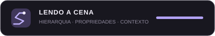
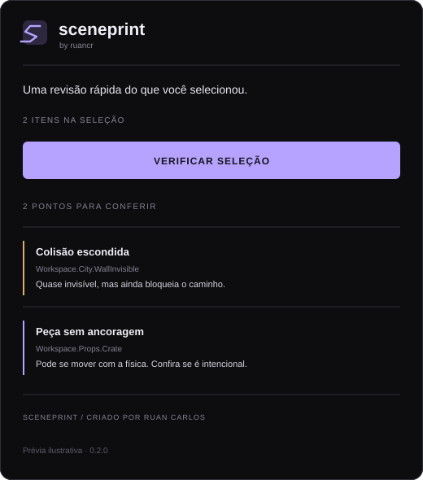

  
  <h1>Sceneprint</h1>
  
<strong>Uma segunda leitura para o seu mapa.</strong>

  
Plugin de auditoria não destrutiva para Roblox Studio.

  

Os números nesta prévia são ilustrativos; a contagem real depende do mapa analisado.

## O que é

Sceneprint percorre a hierarquia de uma experiência no Roblox Studio e reúne situações que merecem uma revisão manual. A ideia não é dizer que o mapa está errado, muito menos consertar tudo automaticamente. É ajudar quem está construindo a experiência a perceber detalhes que podem passar despercebidos durante a montagem.

Cada apontamento tem um código, o objeto relacionado, o motivo da sinalização e uma sugestão do que conferir. Clicar em um resultado seleciona o objeto no Studio.

## O que ele observa

| Código | Verificação | Por que aparece |
|:--|:--|:--|
| **PHY-01** | Conjunto físico sem ancoragem | Pode se mover pela física quando deveria permanecer no lugar. |
| **COL-01** | Peça quase invisível com colisão | Pode bloquear o jogador sem ser percebida. |
| **FX-01** | Emissão intensa de partículas | Vale conferir o efeito em dispositivos de menor desempenho. |
| **LGT-01** | Luz com brilho e alcance amplos | Muitas luzes assim podem pesar na cena. |
| **AUD-01** | Som com alcance longo | O áudio pode alcançar áreas maiores do que o necessário. |
| **GEO-01** | MeshPart com colisão precisa | Uma colisão detalhada pode custar mais do que uma forma simplificada. |
| **UX-01** | ProximityPrompt com alcance elevado | A interação pode funcionar de muito longe. |
| **ORG-01** | Pasta vazia | Pode ser uma estrutura reservada ou algo esquecido. |
| **STR-01** | Workspace grande sem streaming | Lembrete para avaliar carregamento em mapas extensos. |

Os limites são heurísticas de revisão, não regras universais. Um portão invisível, uma peça física solta ou uma luz de grande alcance podem ser exatamente o que o jogo precisa. Leia os detalhes antes de mudar qualquer coisa.

## Instalação

1. Abra o arquivo **Sceneprint.plugin.lua** dentro da pasta **src** e copie o conteúdo.
2. No Roblox Studio, ative **Plugin Debugging Enabled** nas configurações do Studio.
3. Crie um **Script** dentro de **ServerStorage**, substitua o conteúdo pelo código copiado e selecione o Script no Explorer.
4. Na aba **Plugins**, use **Save as Local Plugin** e confirme.
5. O Sceneprint aparecerá na barra de plugins. Apague o Script temporário de ServerStorage e use a cópia carregada pelo PluginDebugService.

A instalação segue o fluxo de plugin local descrito na [documentação oficial do Roblox](https://create.roblox.com/docs/studio/plugins).

## Como usar

1. Clique em **Sceneprint** na barra de plugins.
2. Escolha **WORKSPACE** para analisar o mapa ou **PLACE INTEIRO** para incluir os demais serviços do DataModel.
3. Clique em **ANALISAR CENA**.
4. Filtre entre todos os resultados, itens para revisar e notas.
5. Clique em um apontamento para selecionar o objeto no Explorer.

Uma leitura em andamento pode ser interrompida pelo próprio botão de análise.

## Decisões do projeto

- **Somente leitura:** o plugin não move, apaga, renomeia ou altera propriedades.
- **Sem pontuação artificial:** não existe uma nota de 0 a 100 para um mapa. O resultado é uma lista explicável de verificações.
- **Contexto antes de correção:** cada aviso explica o que foi detectado e por que vale olhar.
- **Sem análise de código-fonte:** o plugin não lê o conteúdo de Scripts, LocalScripts ou ModuleScripts.
- **Sem promessas de benchmark:** a ferramenta não mede FPS nem substitui testes em dispositivos reais.

As regras, limites e possíveis falsos positivos estão em [docs/REGRAS.md](docs/REGRAS.md). As escolhas de escopo e arquitetura estão em [docs/DECISOES.md](docs/DECISOES.md).

## Estrutura

<pre>
projects/sceneprint/
├── assets/
│   ├── sceneprint-mark.svg
│   ├── sceneprint-preview.svg
│   └── sceneprint-scan.svg
├── docs/
│   ├── DECISOES.md
│   └── REGRAS.md
├── src/
│   └── Sceneprint.plugin.lua
├── CHANGELOG.md
├── LICENSE
└── README.md
</pre>

## Estado

**0.1.0 · Protótipo funcional**

O painel, os filtros, a seleção de objetos e as verificações descritas estão implementados. Ainda precisa de testes em experiências de tamanhos e estilos diferentes. Sugestões e problemas reproduzíveis são bem-vindos.

---

Feito para estudar ferramentas de produção no Roblox Studio, com foco em clareza, cautela e utilidade.
