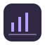
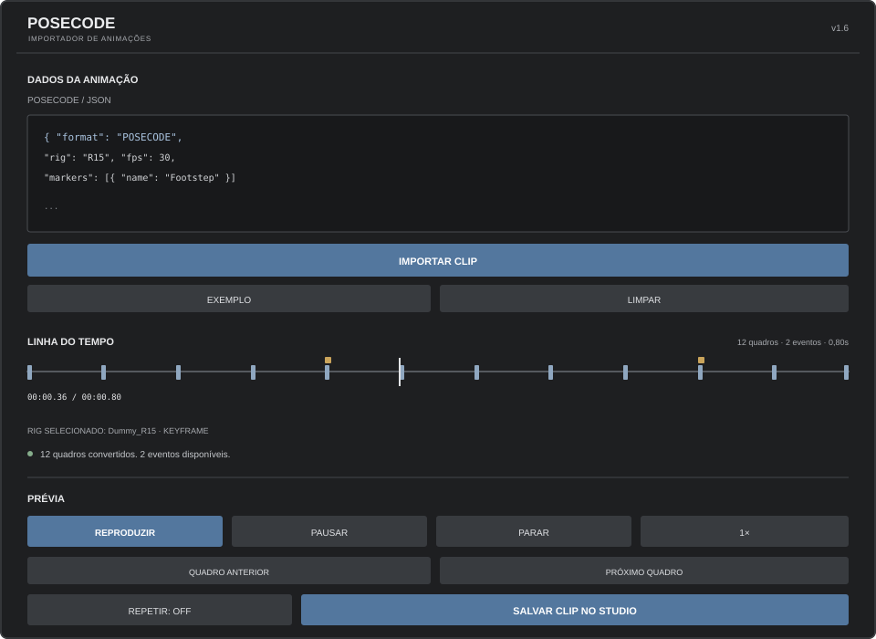

  
  <h1>POSECODE</h1>
  
De uma animação gerada por IA para clips editáveis no Roblox Studio.

  
ruancr · v1.4 · EM DESENVOLVIMENTO

## A proposta

O Posecode recebe um movimento descrito por IA em um formato de dados próprio, converte os quadros em um clip de animação e permite conferir o resultado no rig selecionado.

Ele não tenta adivinhar o comportamento de qualquer script Luau. O texto colado nunca é executado: o plugin extrai apenas o JSON estruturado e valida tempos, juntas e transformações antes de criar o clip.

## Fluxo

1. Selecione um rig R6 ou R15 no Studio.
2. Peça à IA uma animação no formato POSECODE v1.
3. Cole o script ou JSON e clique em **Importar Clip**.
4. Arraste o cursor da linha do tempo, reproduza, pause, altere a velocidade ou avance quadro a quadro.
5. Salve o clip no Studio e publique pelo Editor de Animação.

## Instalar

1. No Roblox Studio, habilite **Plugin Debugging Enabled** nas configurações do Studio.
2. Crie um Script dentro de ServerStorage e cole o conteúdo de [Posecode.plugin.lua](src/Posecode.plugin.lua).
3. Com o Script selecionado no Explorer, use **Plugins → Save as Local Plugin**.
4. Depois de salvar, remova o Script original de ServerStorage e use a cópia do plugin dentro de PluginDebugService.

A documentação oficial do Roblox explica esse fluxo em [Studio plugins](https://create.roblox.com/docs/studio/plugins).

## O que mudou na v1.4

- **Dois formatos de saída:** rigs somente com Motor6D geram KeyframeSequence; rigs com AnimationConstraint geram CurveAnimation (experimental; compatibilidade ainda não garantida pela documentação oficial).
- Curvas de posição com Vector3Curve e rotação com EulerRotationCurve; essa saída é identificada como experimental.
- Linha do tempo arrastável com cursor e leitura do tempo atual.
- Prévia com reproduzir, pausar/retomar, parar e velocidades 0.5×, 1×, 1.5× e 2×.
- Navegação para o quadro anterior e o próximo.
- Botão para carregar um exemplo compatível com o rig selecionado e botão para limpar o campo.
- Rotações padronizadas em XYZ, em graus, e convertidas para a representação de cada clip.
- Restauração de Transform sem escrita em propriedades não suportadas.
- Salvamento com rollback de pastas e referências se a operação falhar.
- Tangentes calculadas para os segmentos cúbicos das CurveAnimations.
- Interface reorganizada com títulos menores, ícones lineares, controles compactos e menos dependência de símbolos tipográficos.
- SVGs de referência mantidos em [assets/icons/posecode-icons.svg](assets/icons/posecode-icons.svg); dentro do Studio, os mesmos desenhos são renderizados por GuiObjects nativos, sem exigir IDs de imagem externos.
- Prévia encerrada automaticamente ao ocultar o painel ou remover o rig do Workspace.
- Limpeza protegida para clips parcialmente criados e animações cuja inicialização falha.
- Correção da leitura de tempo ao limpar a timeline e de espaçamento dos cabeçalhos.
- A versão do formato permanece POSECODE v1; 1.4 identifica somente a versão do plugin.

## Ícones e interface

O arquivo SVG é a fonte vetorial dos símbolos. O Roblox não mostra XML/SVG cru diretamente em um ImageLabel: imagens precisam ser importadas como assets. Para manter o plugin independente, a interface desenha os símbolos com elementos nativos da GUI. [Ver o sprite SVG](assets/icons/posecode-icons.svg).

## Limites atuais

- Não converte scripts Luau arbitrários, TweenService ou lógica condicionada.
- Não executa o conteúdo colado. A entrada aceita até 256 KB.
- Movimento global da raiz, markers/eventos e edição individual de tracks ainda não fazem parte do plugin.
- Em CurveAnimation, os easings aceitos são Linear, Constant e CubicV2 com direção InOut. Elastic e Bounce ficam disponíveis no caminho KeyframeSequence.
- A prévia usa um ID temporário, válido apenas no Studio.
- A publicação na nuvem continua pelo Editor de Animação do Roblox.

## Documentação

- [Formato POSECODE v1](docs/FORMATO.md)
- [Limites técnicos e publicação](docs/LIMITES.md)
- [Código do plugin](src/Posecode.plugin.lua)
- [Histórico de versões](CHANGELOG.md)

## Estado

**Protótipo em desenvolvimento.**