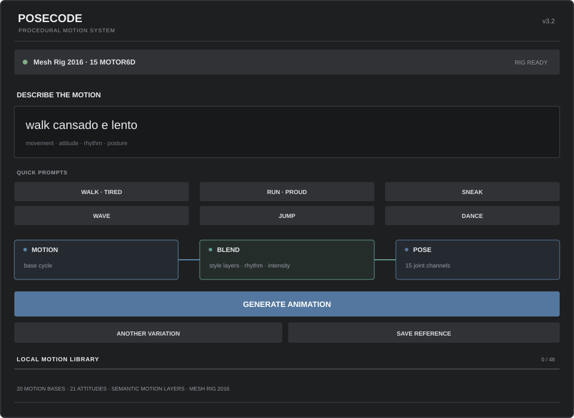

  
  <h1>POSECODE</h1>
  
Gerador procedural de animações para Roblox Studio.

  
ruancr · v3.2 · MESH RIG 2016

## O que é

O POSECODE transforma descrições de movimento em animações procedurais para o Mesh Rig 2016. Em vez de escolher apenas uma animação pronta, o interpretador identifica uma ação principal de locomoção, pode aplicar um gesto secundário e aceita modificadores de corpo, atitude e direção. Em descrições sem locomoção, usa uma única ação gestual.

Exemplos: `walk cansado`, `walk + wave com braço esquerdo`, `run confiante + point`, `sneak olhando para esquerda` e `idle + nod`.

## Interpretação e motor de movimento

- **20 movimentos-base:** walk, run, sprint, sneak, tiptoe, march, limp, idle, wave, salute, jump, bow, point, clap, dance, crawl, strafe, backpedal, stretch e shrug.
- **21 perfis de atitude**, além de neutro: cansado, feliz, confiante, irritado, pesado, triste, robótico, exagerado, casual, sonolento, nervoso, orgulhoso, curioso, brincalhão, sério, relaxado, assustado, tímido, determinado, arrogante e confuso.
- **Composição:** uma ação de locomoção pode ser combinada com um gesto secundário. Exemplo: caminhar enquanto acena; correr enquanto aponta. Ações que são apenas gestos são geradas individualmente.
- **Controles direcionais:** braço esquerdo/direito/ambos, lado da perna na marcha mancando, cabeça olhando para uma direção, aceno de cabeça, balanço de cabeça e espelhamento.
- **Variação procedural:** cada geração usa uma semente diferente para variar fase, amplitude e detalhes sem abandonar o perfil solicitado.
- **Biblioteca local:** até 48 receitas aprovadas, que podem servir de referência para novos pedidos semelhantes.

## O que significa “inteligência” aqui

O POSECODE 3.2 tem um interpretador semântico local baseado em regras, sinônimos e composição de camadas. Ele reconhece intenções e combinações conhecidas; não é um modelo de linguagem, não envia dados para serviços externos e não entende qualquer frase livre. Pedidos com etapas temporais como “primeiro acene, depois sente” ainda não são sequenciados automaticamente.

## Interface

1. Selecione o Mesh Rig 2016 no Explorer.
2. Escreva uma descrição ou escolha uma sugestão rápida.
3. Clique em **Gerar animação**. O plugin interpreta o pedido, valida o rig e sintetiza as poses.
4. Confira a prévia, ajuste velocidade/repetição, gere outra variação ou guarde uma referência.
5. Use **Salvar no Studio** para guardar o clip em AnimSaves.

A faixa MOTION → BLEND → POSE representa a passagem da ação principal para os modificadores e a saída nas juntas. É uma visualização do processo, não um editor de nós separado.

## Instalação e atualização

1. No Roblox Studio, habilite **Plugin Debugging Enabled** nas configurações de Studio.
2. Crie um Script em `ServerStorage`, cole o conteúdo de [Posecode.plugin.lua](src/Posecode.plugin.lua) e selecione **Plugins → Save as Local Plugin**.
3. Depois de salvar, localize a cópia do POSECODE em `PluginDebugService`.
4. **Apague ou deixe de editar o Script original em ServerStorage.** A cópia em `PluginDebugService` é a que o Studio executa e deve receber as alterações.
5. Para aplicar uma atualização, substitua o conteúdo do Script do plugin em `PluginDebugService`, clique com o botão direito nele e escolha **Save and Reload Plugin**.
6. Clique em **POSECODE** na barra Plugins para abrir ou fechar o painel.

O uso de `PluginDebugService` e da opção **Save and Reload Plugin** segue o fluxo de depuração de plugins documentado pelo Roblox.

## Escopo e limites

- Exclusivo do perfil estrutural Mesh Rig 2016 R15 validado pelo plugin.
- Uma ação principal e, no máximo, uma camada de gesto secundário por geração.
- O vocabulário é conhecido e expansível; sequências temporais livres e linguagem ilimitada não são suportadas.
- Dedos individuais não são canais independentes nas 15 juntas usadas.
- A prévia deve ser conferida no Roblox Studio antes de publicar.

## Arquivos

- [Código do plugin](src/Posecode.plugin.lua)
- [Guia de movimentos, combinações e vocabulário](docs/GERADOR.md)
- [Histórico de versões](CHANGELOG.md)
